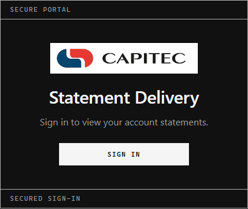
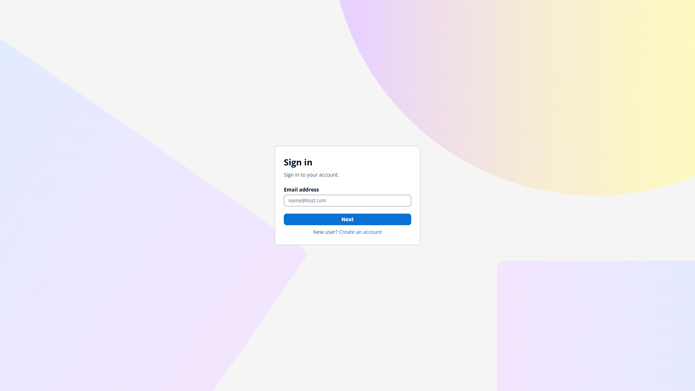

# Secure statement delivery

Customers sign in with Cognito, see their accounts, and open a statement through a short-lived S3 link. An admin uploads the PDF.

The demo address for this project is [https://statement-delivery.duckdns.org](https://statement-delivery.duckdns.org). A clone does not use that environment. You create your own Postgres, Cognito user pool, and S3 bucket, then copy the example config and run the app with those values. Nothing in this repository is an account id, a password, or a token.

## Run it locally

You need JDK 25, Docker, and an AWS account where you can create a Cognito user pool and an S3 bucket.

Start Postgres:

```powershell
docker compose up -d
```

The database listens on `localhost:5433`. The user, password, and database name are `statements` unless you copy `.env.example` to `.env` and change them.

Create the local config from the template:

```powershell
Copy-Item src\main\resources\application-local.yml.example src\main\resources\application-local.yml
```

`application-local.yml` stays on your machine. Fill in the bucket name and the Cognito values from the pool you create below. Leave the access key and the secret key blank if `aws configure` already has credentials. The app then uses that credential chain.

Create the user pool in the Cognito console:

1. Create a user pool in the same region as `app.aws.region`. The template uses `eu-central-1`.
2. Turn on the hosted UI and give it a domain. That domain is `app.cognito.domain`.
3. Create an app client with a client secret and the authorization code grant. Its id is `web-client-id`. Its secret is `web-client-secret`. Put the same id in `api-client-ids` unless you created a second client for the API.
4. Allow these callback and sign-out URLs. The sign-out URL has a trailing slash. The callback URL does not.

   | | URL |
   |---|---|
   | Callback | `http://localhost:8080/login/oauth2/code/cognito` |
   | Sign-out | `http://localhost:8080/` |

5. Scopes are `openid` and `email`. The issuer URI looks like `https://cognito-idp.eu-central-1.amazonaws.com/eu-central-1_abcdef`.
6. Create a group named `ADMIN` and put your admin user in it. Anyone else who can sign in is a customer.

Create an S3 bucket in that same region, block all public access, and put the bucket name in `app.statement.media-context`.

Run the app:

```powershell
.\gradlew.bat bootRun
```

Open [http://localhost:8080](http://localhost:8080).



**Sign in** sends you to the Cognito hosted UI.



After Cognito accepts the password, the app asks for a first and last name if the profile is incomplete. The email comes from the token. You then land on **Accounts**.

- **New account** picks one of the types Flyway inserts: Savings, Credit card, Business, or Personal.
- **View** opens that account's statements. **View** on a statement opens the PDF. **Copy** copies a link that expires 15 minutes after it was signed. The cache on the server drops the link two minutes earlier.
- A user in the group `ADMIN` also sees an **Admin** link at the bottom of the page. That page adds an account type or uploads a statement. The file has to be a PDF, and the bytes have to start with `%PDF`. The upload limit is 25 MB.

Scalar API docs are off in the template. For a local session you can set `scalar.enabled` and `springdoc.api-docs.enabled` to `true` in `application-local.yml`. Leave `app.security.dev-token.enabled` false.

## What the running service guarantees

A statement link is cached on the instance that signed it, keyed by the media row id. A delete drops that entry only after S3 accepts the delete. Another instance never serves a deleted row, because it loads the row from Postgres first.

If an S3 delete fails, a row is written to `storage_deletions` and retried about once a minute. A growing table means objects are still in the bucket. Rows that reach 10 attempts stay in the table and are logged.

`/actuator/health/liveness` is open. Readiness, including the database, and `/actuator/metrics` require an admin session.

Flyway applies `V1` through `V6` on an empty database. Those files stay as they are. The next schema change is a new version after `V6`.

## GitHub Actions

`.github/workflows/ci.yml` runs the test suite on every push and pull request. It needs no AWS configuration.

`.github/workflows/deploy.yml` builds the jar and restarts the host when these repository variables are set. A repository without `AWS_DEPLOY_ROLE_ARN` skips the deploy job. The values stay in GitHub.

| Variable | Purpose |
|---|---|
| `AWS_DEPLOY_ROLE_ARN` | IAM role that GitHub Actions assumes |
| `AWS_REGION` | Region of the instance and the bucket |
| `PARAMETER_PREFIX` | Optional. Defaults to `/statements/prod` |

The workflow reads the bucket name and the instance id from Parameter Store. Add the variables under Settings, Secrets and variables, Actions, Variables.
